# VideoCoS: When Do Executable World States Help Video Reasoning and Generation?

This is the official implementation of **VideoCoS** (**Video** reasoning and generation via **Co**de **S**tates).

<!-- TODO(release): the arXiv and project-page links -->
[](#)  [](#)  [](https://huggingface.co/datasets/Shoubin/VideoCoS-demo)

### Authors: [Shoubin Yu\*](https://yui010206.github.io/), [Daeun Lee\*](https://daeunni.github.io/), [Zun Wang](https://zunwang1.github.io/), [Han Lin](https://hl-hanlin.github.io/), [Yue Zhang](https://zhangyuejoslin.github.io/), [Mohit Bansal](https://www.cs.unc.edu/~mbansal/)

### University of North Carolina at Chapel Hill

\* Equal contribution.

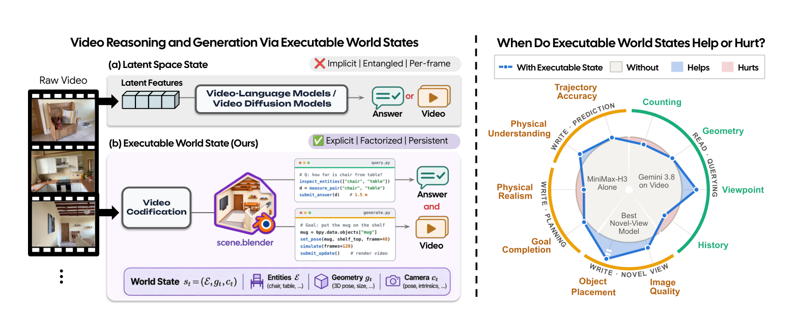

Figure 1. **Executable world state for unified video reasoning and generation.** Left: unlike VLMs and video diffusion
models with implicit, entangled latents, VideoCoS codifies a video once into an executable program (`scene.blender`), an
explicit, factorized and persistent state that a reasoning agent queries (`query.py`) to answer questions, or edits and
simulates (`generate.py`) to render new videos. Right: performance across the Read and Write axes relative to base models
without an executable state (gray). Blue shows gains (e.g., viewpoint, object placement, goal completion, physical
understanding); pink shows bottlenecks (history, physical realism).

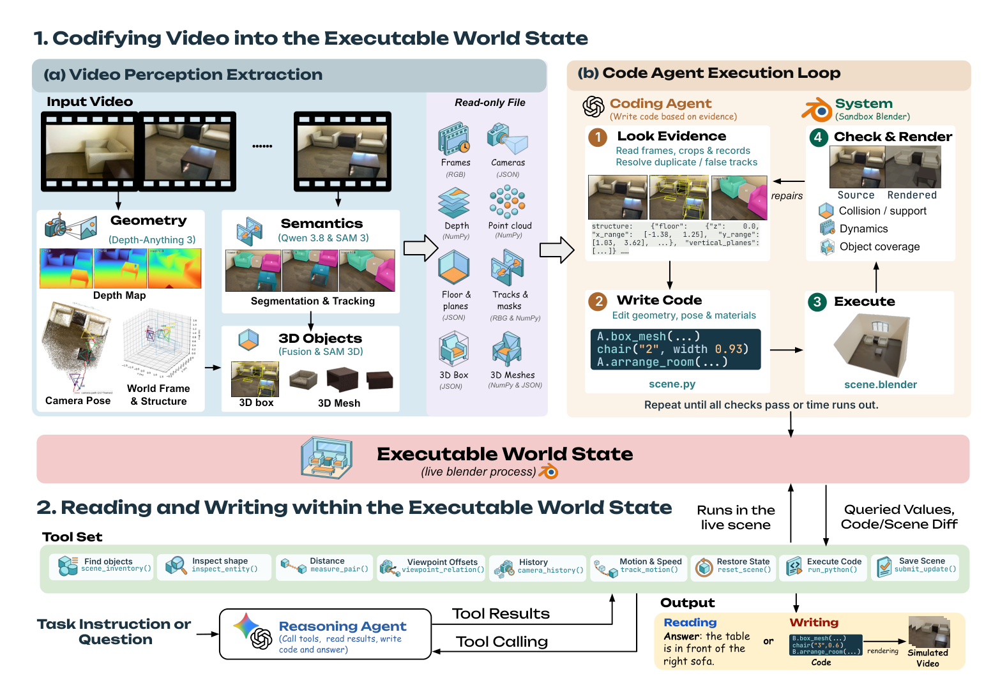

Figure 3. **Overview of VideoCoS.** The codification agent turns perception evidence into an executable scene program
through a loop of building, checking and rendering. The reasoning agent then reads this scene to answer questions, or
edits and simulates it to generate videos. It only receives text feedback from tools and never sees the frames.

## Results

### Video → executable scene (T1–T4, VSI-Bench rooms)

<table>
<tr><td width="64%">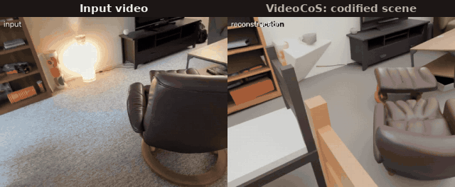</td><td>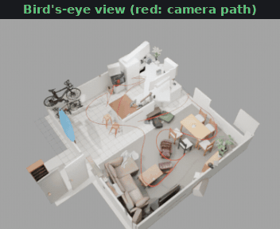</td></tr>
<tr><td colspan="2"><em>An apartment (living room, kitchen, dining area): 182 s walkthrough, 188 objects; average score 0.79 on its 31 questions across T1–T4.</em></td></tr>
<tr><td width="64%">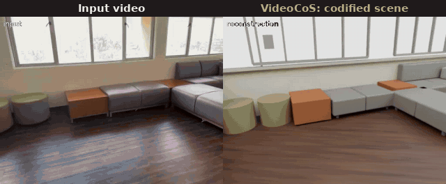</td><td>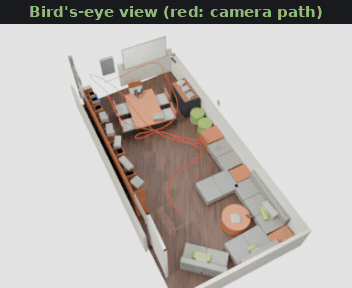</td></tr>
<tr><td colspan="2"><em>A lounge: 103 s walkthrough, 171 objects; average score 0.86 on its 14 questions.</em></td></tr>
<tr><td width="64%">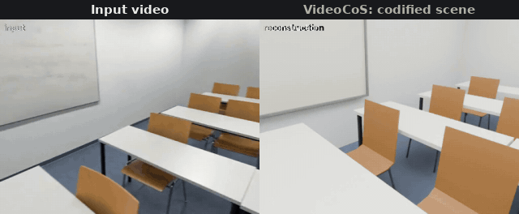</td><td>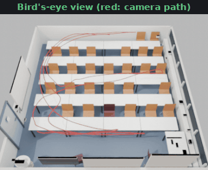</td></tr>
<tr><td colspan="2"><em>A classroom: 152 s walkthrough, 96 objects; average score 0.94 on its 17 questions.</em></td></tr>
</table>

Left: part of the input walkthrough (about 3x speed) beside the codified Blender scene, rendered from the camera that
perception recovered. Right: the whole scene from above (ceiling removed, walls cut at 1.2 m), with the camera path in
red. The reasoning agent answers the VSI-Bench questions (counting, size, distance, direction, order) from this scene
alone, never from the frames. The scores are from the paper's run (Gemini 3.8 Flash; VSI-Bench scoring, 0 to 1).

### Novel-view synthesis (T5, Kubric-4D)

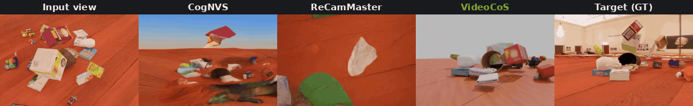
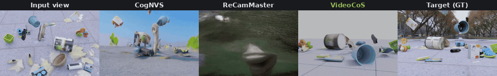

The same 60 frames from a target camera 128° away from the input view. VideoCoS moves the camera in the codified scene
and renders it; the video models (CogNVS, ReCamMaster) have to imagine the unseen view.

### Goal-conditioned planning (T6, Ego2Act)

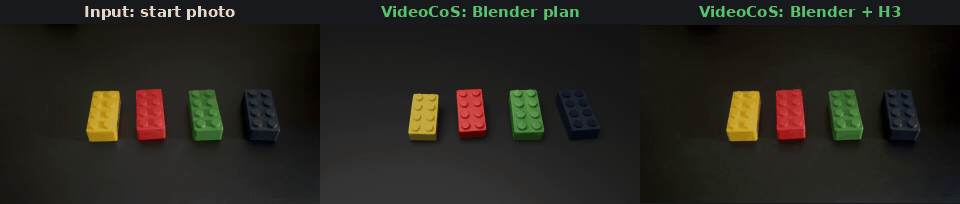

*Goal: "The blocks are stacked from bottom to top in this order: yellow, green, red, blue."*

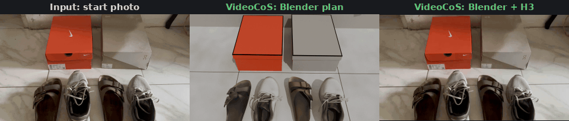

*Goal: "Sandals stored inside the closed orange box, with the shoes stored inside the closed brown-and-white box."*

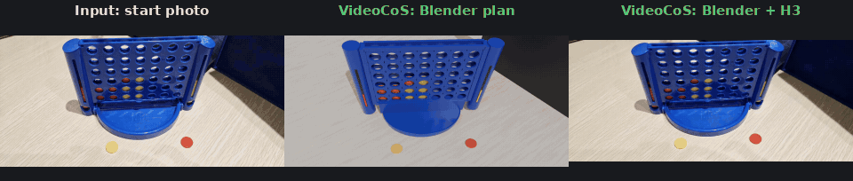

*Goal: "Put the final move of the game to win as either side."*

From one start photo and a goal, the reasoning agent animates a 15 s plan in the codified scene (Blender plan); MiniMax-H3
then renders the plan photoreal from the real photo and adds the hand (Blender + H3).

### Future prediction (T7, Physics-IQ)

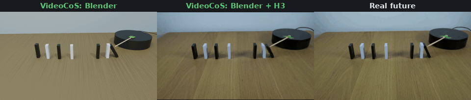
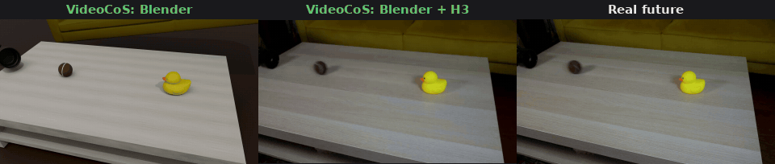
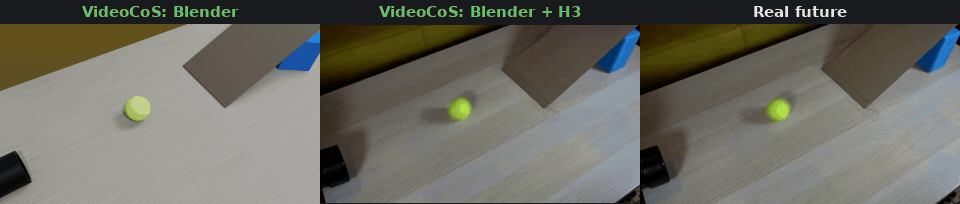

From a 3 s clip, the reasoning agent sets up and simulates the next 5 s in Blender; MiniMax-H3 renders the prediction
photoreal from the last observed frame. Right: what really happened (take 1).

## Repository

VideoCoS has three stages; each folder has its own README.

| Folder | Stage | What it does |
|---|---|---|
| [`codification/`](codification/README.md) | video → scene | Perception models (Depth Anything 3, Qwen3.8-27B, SAM 3, SAM 3D) build the evidence; a Codex agent writes, builds and repairs `scene.py` in a sandboxed Blender. |
| [`reasoning/`](reasoning/README.md) | scene → answer or new scene | A language model (Gemini 3.8 Flash in the paper) queries the scene with tools, or edits and simulates it with Python, and the result is rendered in Blender. |
| [`render/`](render/README.md) | plan → photoreal video | MiniMax-H3 renders the Blender plan from the real frame (T6, T7). |
| [`bench/`](bench/README.md) | the tasks | `bench/meta/tasks/T1.json … T7.json` (2,838 samples) and where to get their videos and images. |
| `scripts/` | data | `download_demo.sh` (the demo data), `fetch_vsi_videos.py` (T1–T4 room videos from VSI-Bench). |

| Task | Input | Reasoning | Render |
|---|---|---|---|
| T1–T4: entity, geometry, viewpoint, history queries | a room walkthrough and a question | query tools → answer | – |
| T5: novel-view synthesis | a Kubric-4D clip and a target camera | move the camera | Blender |
| T6: goal-conditioned planning | an egocentric photo and a goal | animate the plan | Blender, then H3 adds the hand |
| T7: future prediction | a 3 s Physics-IQ clip | simulate the next 5 s | Blender, then H3 |

## Installation

Each stage installs on its own; set up only the stages you need.

- **Reasoning:** Python ≥ 3.9 (standard library), Docker, Blender 4.5 for Linux x64 (`VIDEOCOS_BLENDER_DIR`), a
  sandbox image built from a 5-line Dockerfile, and a Gemini API key (`GEMINI_API_KEY`). No GPU.
- **Render:** GPUs with ≥ 80 GB (two per server in the paper), the conda env from `render/setup_env.sh` (SGLang) and the
  MiniMax-H3 Ref2VA weights (`H3_MODEL_PATH`).
- **Codification:** GPUs with ≥ 80 GB, one Python environment per perception model (vLLM, Depth Anything 3, SAM 3,
  SAM 3D Objects) plus their weights, Docker, Blender 4.5 and a logged-in Codex CLI. Fill in
  `codification/configs/machine.json`; `perception.py check` reports anything missing.

Data and run locations default to this repository; `VIDEOCOS_BENCH` and `VIDEOCOS_REASONING_RUN` move them.

## Quick start with the demo data

```bash
bash scripts/download_demo.sh     # 80 MB from Hugging Face: inputs of 2 samples per task, 8 codified scenes, the paper's outputs
```

The script downloads [Shoubin/VideoCoS-demo](https://huggingface.co/datasets/Shoubin/VideoCoS-demo), unpacks it into
`bench/data/` and `demo/`, checks every file, and fetches the two demo room videos from VSI-Bench.

The demo includes codified scenes, so you can start at any stage.

**Reasoning** (no GPU), from `reasoning/`:

```bash
python3 -m pytest -q tests/                                     # 14 tests
python3 run.py --examples ../demo/examples --out runs/fake --fake            # every tool once, no API calls
GEMINI_API_KEY=... python3 run.py --examples ../demo/examples --out runs/demo --max-usd 3 --jobs 7 --render \
  --ids T1_vsi_4589,T2_vsi_3166,T3_vsi_3675,T4_vsi_4179,T5_scn02900_v0_v12,T6_stack_blocks,T7_0050_center_dominos-with-space
```

One task per family; it took us about $1 and under an hour, most of it the Blender renders of T6 and T7.

**Render** (2 GPUs), from `render/` in the `h3render` env:

```bash
export VIDEOCOS_REASONING_RUN=../reasoning/runs/demo H3_MODEL_PATH=/path/to/MiniMax-H3
python t6_h3/prepare.py --ids T6_stack_blocks && python t6_h3/make_prompts.py --ids T6_stack_blocks
python t6_h3/make_t7_inputs.py
bash serve_h3.sh 0,1 30021        # wait until logs/serve_30021.log says "fired up"
python t6_h3/generate_t7_ref2va.py --server http://127.0.0.1:30021 --ids T7_0050_center_dominos-with-space --name demo_t7
python t6_h3/generate.py --server http://127.0.0.1:30021 --ids T6_stack_blocks --name demo_t6
bash stop_h3.sh 30021
```

About 10 minutes for T7 and an hour for T6 on two RTX PRO 6000.

**Codification** (1 GPU), from `codification/` with the harness Python as `$PY`:

```bash
$PY perception.py run --gpus 0 --queue queues/demo.json      # or one input: --video clip.mp4 --task T7 --id my_clip
$PY codification.py run --queue queues/demo.json --gpus 0 --watch
```

A 3 s clip takes about 20 minutes and a room 2 hours. The new scenes then go to the reasoning stage:
`run.py --scenes ../codification/outputs --families T7 ...` for T5–T7, and `make_room_examples.py` followed by
`run.py --examples` for T1–T4.

## Data

The task manifests are in `bench/meta/tasks/`; every media path in them is relative to `bench/`. The demo puts the
media of its samples there. For the full benchmark, [`bench/README.md`](bench/README.md) lists where to download each
source (VSI-Bench, Kubric-4D, Ego2Act, Physics-IQ Verified) and its license.

## Reproducing the paper

1. **Codification:** `queues/vsi.json` (274 rooms, T1–T4) and `queues/t5_t7.json` (276 inputs, T5–T7), as in
   [`codification/README.md`](codification/README.md).
2. **Reasoning:** `make_room_examples.py` and `run.py --examples` for T1–T4; `run.py --scenes --families T7,T6,T5`, then
   `--render-only`, for T5–T7 ([`reasoning/README.md`](reasoning/README.md)).
3. **Render:** `render/scripts/run_t6_t7.sh --baseline` after the three preparation scripts
   ([`render/README.md`](render/README.md)).

The evaluation scripts are not part of this repository.

## Citation

<!-- TODO(release): the arXiv identifier -->
```bibtex
@article{yu2026videocos,
  title   = {VideoCoS: When Do Executable World States Help Video Reasoning and Generation?},
  author  = {Yu, Shoubin and Lee, Daeun and Wang, Zun and Lin, Han and Zhang, Yue and Bansal, Mohit},
  journal = {arXiv preprint},
  year    = {2026}
}
```

## Acknowledgments

VideoCoS builds on [Blender](https://www.blender.org/), [SAM 3](https://github.com/facebookresearch/sam3),
[SAM 3D Objects](https://github.com/facebookresearch/sam-3d-objects),
[Depth Anything 3](https://github.com/ByteDance-Seed/Depth-Anything-3), Qwen, [MiniMax-H3](https://huggingface.co/MiniMaxAI/MiniMax-H3)
and [SGLang](https://github.com/sgl-project/sglang), and evaluates on [VSI-Bench](https://huggingface.co/datasets/nyu-visionx/VSI-Bench),
[Kubric-4D](https://huggingface.co/datasets/basilevh/Kubric-4D), [Ego2Act](https://huggingface.co/datasets/ego2act/ego2act-bench)
and [Physics-IQ Verified](https://huggingface.co/datasets/Anates-Labs-Research/Physics-IQ-Verified). We thank their authors.
